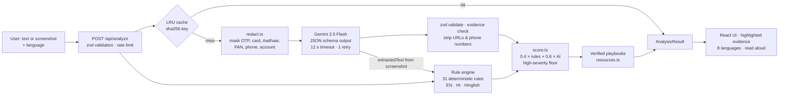

# Satark (सतर्क) — check any message before you trust it

[](https://github.com/prajapatipratik547-ui/Satark-ai/actions/workflows/ci.yml)

**Live app:** https://satark-ai-k8f6.onrender.com · Built solo for **PromptWars × Kick To Tech 2026** (Google for Developers × Hack2skill).

## The problem

Every day, Indian families receive scam messages: fake KYC alerts, "digital arrest" threats from fake police or CBI officers, UPI collect-request tricks, parcel and electricity-cut scams, task-job and investment frauds. I4C data (National Cyber Crime Reporting Portal) shows about **₹19,813 crore reported lost to cyber fraud in 2025, across roughly 21.8 lakh complaints**. The people most at risk, such as elderly parents and first-time smartphone users, often can't read the English in these messages and have nobody to ask at the moment the message arrives.

## The solution

**Satark is a personal digital safety assistant for Indian families.** It answers the three questions a worried person actually has: _Is this a scam? How do you know? What do I do now?_

Paste a message or upload a screenshot, and within seconds you get, in your own language:

1. **A verdict** (**Scam / Suspicious / Looks safe**) with a 0–100 risk score and the scam type (e.g. "Digital arrest", "Fake KYC", "UPI collect request").
2. **The evidence**: the exact red-flag words **highlighted inside the original message**, each with a one-line reason and a tag showing whether the rule engine or the AI found it.
3. **Next steps for your situation.** Pick _I only received it_, _I clicked a link or shared details_, or _I already sent money_, and get a step-by-step playbook that points **only** to verified official channels: **1930**, **cybercrime.gov.in** and **Sanchar Saathi Chakshu**.
4. **Eight languages** (English, हिंदी, मराठी, தமிழ், తెలుగు, বাংলা, ગુજરાતી, ಕನ್ನಡ), **Read aloud**, **Share warning with family**, a **larger-text** mode, and a permanent **"Already paid? Call 1930 now"** button.

No account, no app install, nothing stored.

## How Satark differs from reputation-based checkers

Satark doesn't claim to be the first scam checker. Truecaller launched a free Scam Checker in India on 28 Sep 2026, which checks numbers and links against crowd-reported data (screenshot upload was announced but not shipped). Satark **complements** that kind of tool:

|                                                | Reputation lookup (number/link reported by others) | Satark                                                           |
| ---------------------------------------------- | -------------------------------------------------- | ---------------------------------------------------------------- |
| Brand-new scam from a fresh, unreported number | Often unknown                                      | **Reads the message itself**, so the wording still gives it away |
| Why it was flagged                             | A reputation score                                 | **Highlights the exact words** and explains each one             |
| WhatsApp screenshot forwarded by family        | —                                                  | **Reads screenshots** with Gemini                                |
| Users who don't read English                   | Limited                                            | **8 Indian languages + read aloud**                              |
| What to do next                                | —                                                  | **Situation-specific playbook** with official channels only      |

## Hybrid analysis: rules + Gemini



- **Rule engine** (`src/server/engine/rules.ts`): 31 pure, unit-tested rules covering urgency and threats, OTP/PIN/CVV requests, KYC updates, digital arrest and fake officials, UPI collect / "enter PIN to receive", lottery/KBC, task jobs and Telegram groups, guaranteed returns, electricity cuts, parcels held at customs, AnyDesk/TeamViewer, shortened links, lookalike bank domains, `.apk` links and "safe account" transfers, with Hindi and Hinglish variants. Every match returns character offsets for highlighting. The engine is fast, explainable, and keeps working if the AI is down or rate-limited.
- **Gemini** (`src/server/ai/`) adds contextual judgement, scam-type classification, **screenshot reading** (the rules then run again on the text it read) and the explanation in the user's language.
- **Merge** (`src/server/engine/score.ts`): `final = round(0.4 × ruleScore + 0.6 × aiScore)`, or the rule score alone if the AI fails. Any high-severity hit (OTP request, remote-access app, safe account, digital arrest) can never be shown as "safe". Verdict: ≥ 70 scam, 35–69 suspicious, < 35 safe.

### How Gemini is used, and kept honest

- Structured output: `responseMimeType: "application/json"` with a `responseSchema`; every reply is validated with zod, and anything malformed falls back to rules only.
- **Evidence check:** every AI red flag must quote words that really appear in the message (normalised substring match). Invented phrases are dropped.
- **Gemini never supplies a phone number, link or reporting channel.** All of those come from one static file, `src/shared/resources.ts`. The server strips URLs, phone numbers, emails and UPI IDs from AI-written text, and tests enforce it.
- Speed and quota: 12 s timeout via `AbortController`, at most one retry within a 15 s budget, thinking disabled for latency, and an in-memory LRU (200 entries, 1 h) so repeated checks don't use up the free-tier quota.

## Verified guidance (safety-critical)

| Situation                                       | Where Satark sends you                                                                                                                          |
| ----------------------------------------------- | ----------------------------------------------------------------------------------------------------------------------------------------------- |
| Money already lost                              | Call **1930** (national cyber-crime helpline) and report at **https://cybercrime.gov.in**, as fast as possible                                  |
| Suspicious call / SMS / WhatsApp, no money lost | Report on **Chakshu**: https://sancharsaathi.gov.in/sfc/ (messages from the last 30 days)                                                       |
| Card or bank details shared                     | Call your bank using the number **printed on your card or in the bank's official app** (never a number from the message) and block the card/UPI |

The playbooks are deterministic, translated into all 8 languages, and unit-tested: each one contains the right channel and no other number or website.

## Measured accuracy

`npm run eval` runs the rule engine over **33 labelled messages we wrote ourselves** (`tests/fixtures/messages.json`: 22 scams across every category above in English, Hindi and Hinglish, plus 11 genuine messages such as real-style bank OTPs that say "do not share", delivery updates, a bill reminder and family messages). A message counts as flagged when the verdict is Scam or Suspicious.

| Rule engine only (latest run)  |                            |
| ------------------------------ | -------------------------- |
| Accuracy                       | 100% (33/33)               |
| Precision                      | 100%                       |
| Recall                         | 100% (22/22 scams flagged) |
| Genuine messages marked "Scam" | 0                          |

**Please read these numbers with care:** the rules were developed alongside these fixtures, so this is a regression check, not an estimate of real-world accuracy. Real scams vary far more. CI fails if recall drops below 0.8 or any genuine message is marked "Scam". `npm run eval -- --ai` runs the full rules + Gemini pipeline (one request per message, so it uses free-tier quota). We haven't published its numbers because we haven't run it on the full set yet.

## Security and privacy

- **Prompt-injection defence.** Scam messages are written by attackers, so the message is treated strictly as data:
  - It is wrapped in markers with a **random per-request boundary** that the attacker can't predict or close; any copy of the boundary inside the message is removed.
  - The system instruction says the content is untrusted data and that instructions inside it are a red flag, never something to follow. A dedicated rule also flags phrases like "ignore previous instructions".
  - Model output can only fill the response schema. If the AI calls a message safe but the rules disagree (e.g. the model was fooled), its reassuring summary is **discarded** and the verdict stays flagged. A test covers exactly this.
- **Privacy:** OTPs, card, Aadhaar, PAN, account and phone numbers are masked before any text is sent to Gemini. There is no database, message content is never logged (only error types), and cache keys are SHA-256 hashes.
- **Input validation:** a strict zod schema (unknown fields rejected), 4,000-character text limit, image MIME allow-list (PNG/JPEG/WebP), 4 MB image cap, 6 MB body limit.
- **HTTP hardening:** helmet with a strict CSP (`default-src 'self'`, no inline scripts or styles, `img-src 'self' data: blob:`, `frame-ancestors 'none'`), HSTS, `no-referrer`, a Permissions-Policy header, rate limiting (20 requests/min per IP on `/api`), server timeouts, and a central error handler that never returns stack traces.
- **Secrets:** `GEMINI_API_KEY` lives only in the server environment (a Render environment variable, or Secret Manager on Cloud Run). It is never sent to the browser or committed; `.env` is git-ignored.
- **Container:** multi-stage build on `node:22-slim`, production dependencies only, runs as the non-root `node` user. `npm audit --omit=dev` reports 0 vulnerabilities and runs in CI.
- **Regex safety:** every rule uses bounded repetition, and a test feeds long hostile input to check for catastrophic backtracking.

## Accessibility (WCAG 2.2 AA)

Lighthouse on the live site: **Accessibility 100 · Performance 99 · Best Practices 100 · SEO 100.**

- Semantic landmarks, one `h1`, a skip link, labelled controls, a visible focus ring, and buttons at least 44 px tall.
- Results are announced through an `aria-live="polite"` region. The verdict uses **icon + word + colour**, never colour alone, and the result container has the correct `lang` attribute.
- Highlighted evidence uses `<mark>` with screen-reader text ("warning sign: …") plus a wavy underline, so it doesn't rely on colour.
- **Larger-text** toggle; **Read aloud** with the Web Speech API (voice matched to the language; hidden where unsupported); `prefers-color-scheme` and `prefers-reduced-motion` respected.
- Keyboard-operable tabs (arrow keys), and screenshot upload that works by keyboard (native file input) or drag-and-drop.
- Mobile-first, single-column layout designed for 360 px screens; long words and links wrap instead of scrolling sideways.
- Automated: axe (via `vitest-axe`) reports no violations on the start screen or a full result.

## Efficiency

- Gzip compression; content-hashed assets cached for a year (`immutable`), `index.html` served `no-cache`.
- Screenshots resized in the browser to at most 1600 px and re-encoded as WebP/JPEG before upload.
- The web bundle is kept free of zod: 86 kB gzipped JS, 2.6 kB CSS.
- LRU cache, Gemini timeout and retry budget, multi-stage Docker image with production dependencies only.

## Tests

**204 tests** across 12 files (`npm test`), run in CI on every push together with lint, typecheck, eval, build and `npm audit`:

| Area                                                                                                 | File                | Tests |
| ---------------------------------------------------------------------------------------------------- | ------------------- | ----- |
| Rule engine (every rule, negatives, offsets, ReDoS guard, injection)                                 | `rules.test.ts`     | 59    |
| API: validation, fallback, evidence check, URL/phone stripping, prompt injection, cache, screenshots | `api.test.ts`       | 25    |
| Highlighting, resizing, translation completeness and safety                                          | `web-lib.test.ts`   | 30    |
| AI-text sanitising, prompt boundary, LRU cache                                                       | `sanitize.test.ts`  | 20    |
| PII redaction                                                                                        | `redact.test.ts`    | 14    |
| Score merge and verdict boundaries                                                                   | `score.test.ts`     | 13    |
| Gemini client with `vi.mock` (schema, retry, timeout)                                                | `gemini.test.ts`    | 12    |
| UI components + axe accessibility                                                                    | `ui.test.tsx`       | 11    |
| Verified resources and playbooks                                                                     | `resources.test.ts` | 8     |
| Security headers, rate limiting, no stack traces                                                     | `security.test.ts`  | 5     |
| Static serving and cache headers                                                                     | `app.test.ts`       | 5     |
| Accuracy thresholds on fixtures                                                                      | `eval.test.ts`      | 4     |

## Run it locally

Requires Node 22+.

```bash
npm ci
cp .env.example .env          # add your GEMINI_API_KEY (optional: without it Satark runs rules-only)
npm run dev                   # API on :8080, web on Vite's dev server with a proxy
```

Other scripts: `npm test`, `npm run lint`, `npm run typecheck`, `npm run eval` (add `-- --ai` for the full pipeline), `npm run build && npm start`.

## Deploy

The app is one container that listens on `$PORT`.

- **Render (current deployment):** New Web Service → this repo → runtime **Docker** → set `GEMINI_API_KEY` and `GEMINI_MODEL=gemini-2.5-flash` → health check path `/healthz`. It redeploys on every push to `main`.
- **Google Cloud Run** (same Dockerfile, key in Secret Manager):
  ```bash
  printf '%s' 'YOUR_KEY' | gcloud secrets create GEMINI_API_KEY --data-file=-
  gcloud run deploy satark --source . --region asia-south1 --allow-unauthenticated \
    --set-secrets GEMINI_API_KEY=GEMINI_API_KEY:latest --memory 512Mi --max-instances 3
  ```

## Project structure

```
src/
  shared/   types, zod schemas, languages, verified resources + playbooks (+ translations)
  server/   Express app, /api/analyze route, analysis pipeline, LRU cache
    engine/ rules.ts · redact.ts · score.ts · rule-reasons.ts
    ai/     gemini.ts · prompt.ts · sanitize.ts
  web/      React app: components, i18n, highlight, image resize, speech
tests/      Vitest unit, API, component and accessibility tests + fixtures
scripts/    eval.ts (accuracy evaluation)
```

## Limitations

- The rule engine recognises known patterns. A cleverly worded new scam may only be caught by the AI, and when the AI is unavailable that message can come back "Looks safe". The UI says when a result is rules-only.
- Interface text is complete in English, Hindi and Marathi. In Tamil, Telugu, Bengali, Gujarati and Kannada, the result, next steps and AI explanation are translated, while some form labels stay in English.
- Satark gives guidance, not legal or financial advice. If money was lost, call 1930 immediately.
- The free hosting tier sleeps when idle, so the first request after a pause can take up to a minute.
